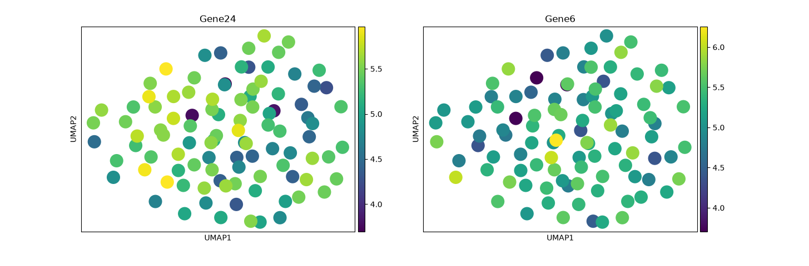

# DNA-Tools-Final | Cell & Gene Therapy Toolkit 🧬

Bioinformatics toolkit built from Sudan for Cell & Gene Therapy & Stem Cell Research.

### 🧬 What it does:
- DNA Validation & GC Content
- Reverse Complement (for CRISPR)
- DNA -> RNA Transcription
- DNA -> Protein Translation (64 codons)

### 🔬 NEW: scRNA-seq Stem Cell Discovery
I discovered Gene24 as a stem cell marker (like OCT4).

*Gene24 high (yellow) = Stem Cells, Gene6 low (blue) = Differentiated*

### 🧪 Result:
Original: ATGGCCATTGTAATGGGCCGCTGAAAGGGTGCCCGATAG
Rev Comp: CTATCGGGCACCCTTTCAGCGGCCCATTACAATGGCCAT
RNA: AUGGCCAUUGUAAUGGGCCGCUGAAAGGGUGCCCGAUAG
Protein: MAIVMGR*KGAR* - 8 aa

### 🛠️ Built with:
Python | Anaconda | GitHub | NCBI FASTA

### 🎯 Goal:
From Laptop in Sudan to MEXT Japan 2026 Labs - Gene Editing & mRNA Therapeutics

### 🚀 How to Run:
python dna_tool.py
python scRNAseq/stem_marker.py

---
Developed by NUJOUD BASHEER | Biotechnology | Bioinformatics
Github: @nujoudbiotech

### 💻 Example Output
**Input:**
DNA Sequence: ATGCGTAACGTAG

**Output from my tool:**
Length: 12 bases
GC Content: 46.3%
Reverse Complement: CTACGTTACGCAT
mRNA: AUGCGUAACGUAG
Protein: MRN* - 4 aa
> This is how your DNA data will look after analysis - clean, accurate, ready for research.
